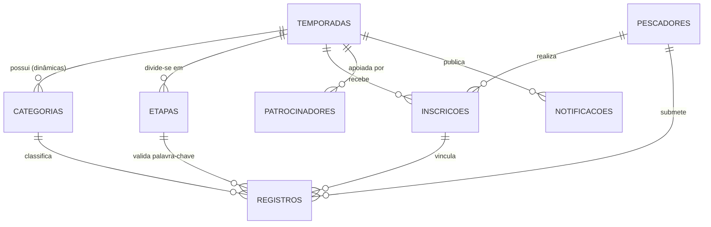

# Arquitetura Desengessada — Plataforma de Torneios de Pesca Esportiva

## 1. Visão Geral e Princípios Arquiteturais

Esta arquitetura foi projetada a partir da engenharia reversa da estrutura de rotas de `https://torneiodepesca.app.br/` e dos documentos operacionais do **Ranking Eldorado Pesca**, eliminando qualquer rigidez (*hardcoding*) de regras, categorias, espécies, fórmulas de pontuação ou checklists de arbitragem.

### Decisões-Chave de Engenharia
1. **Motor de Banco de Dados Relacional Real (`node:sqlite` + PostgreSQL/Supabase Ready):**
   - Enquanto o projeto Supabase (`tfttmfbfzyymuwiwpxyw`) encontra-se temporariamente suspenso até o dia 13, o sistema **não utiliza mocks voláteis em `localStorage`** como fonte de verdade.
   - Utiliza o motor SQL nativo do Node.js 24 (`node:sqlite` com `DatabaseSync` em modo `WAL` e `foreign_keys = ON`), persistindo os dados em disco em `D:\torneio\data\torneio.db`.
   - O esquema SQL (`D:\torneio\supabase_schema_torneio.sql`) é 100% compatível com PostgreSQL/Supabase e com qualquer backend REST externo (Node, PHP, Go).
2. **Armazenamento Real de Mídia em Disco (`/api/upload` → `D:\torneio\public\uploads\`):**
   - Fotos de medição na régua, vídeos de soltura sem cortes e comprovantes de inscrição são gravados diretamente no disco local (`D:\torneio\public\uploads\`) e servidos estaticamente, com adaptador pronto para Supabase Storage (`buckets/capturas`).
3. **Motor de Regras 100% Parametrizado no Banco de Dados:**
   - **Temporadas (`temporadas`):** Configura nome, subtítulo, logo oficial (`/brand/logo-eldorado-amarelo-tight.png` ou `/brand/logo-eldorado-branco-tight.png`), valor de inscrição, chave Pix, percentual de desconto no comércio parceiro, permissão de inscrição em múltiplas categorias com o mesmo peixe e regulamento completo.
   - **Categorias Dinâmicas (`categorias`):** O administrador pode criar, editar ou desativar qualquer categoria pelo painel (`/painel/admin/temporadas`), definindo:
     - `especie` (ex.: `Dourado`, `Traíra (Hoplias malabaricus)`, `Tucunaré`, `Piapara`)
     - `modalidade` (`embarcado`, `caiaque`, `barranco_acude`, `livre`)
     - `formula_ranking`:
       - `soma_top_n`: Soma das `N` maiores capturas aprovadas do pescador na categoria (ex.: Soma dos 3 maiores peixes).
       - `maior_exemplar`: Apenas o maior exemplar homologado do pescador na categoria.
       - `soma_total`: Soma de todas as capturas homologadas sem limite de quantidade.
       - `media_top_n`: Média aritmética das `N` maiores capturas.
     - `criterio_desempate`: `maior_peixe` (maior exemplar individual seguido da captura mais antiga) ou `captura_mais_antiga`.
     - `medida_minima`, `tempo_max_fora_agua_seg`, `tempo_max_video_seg`.
     - `checklist_validacao_json`: Array JSON de critérios dinâmicos exibidos na Mesa de Arbitragem para aquela categoria específica.
     - `premiacao_json`: Array JSON com a premiação de cada colocação (`1º Lugar`, `2º Lugar`, `3º Lugar`).
4. **Exclusão Total de Módulos Estranhos ao Domínio:**
   - Nenhum módulo de câmera de ação / GoPro faz parte desta arquitetura; o sistema é 100% dedicado à gestão, operação, submissão, arbitragem e classificação de torneios de pesca esportiva.

---

## 2. Diagrama Entidade-Relacionamento (ERD)

---

## 3. Mapa de Rotas (Fiel ao `torneiodepesca.app.br`)

### Rotas de Interface (App Router)
| Rota | Perfil | Responsabilidade |
|---|---|---|
| `/login` | Público | Autenticação por WhatsApp (apenas números) + Senha, com troca rápida de perfil para homologação. |
| `/painel` | Pescador / Público | Visão geral da temporada ativa, palavra-chave oficial da etapa em andamento, resumo de classificação por categoria, últimas capturas homologadas e comunicados fixados. |
| `/painel/etapas` | Pescador / Público | Lista de etapas da temporada, locais de pesca, datas, status, palavra-chave vigente e regras de cada etapa. |
| `/painel/inscricoes` | Pescador | Status da inscrição do pescador, número oficial (`#001`), chave Pix da etapa, envio de comprovante e acesso ao passaporte de descontos no comércio parceiro. |
| `/painel/registros` | Pescador | Formulário dinâmico de envio de captura (adaptado às regras e medida mínima da categoria escolhida, upload real de foto/vídeo) + histórico de capturas enviadas e parecer do juiz. |
| `/painel/ranking` | Pescador / Público | Classificação oficial em tempo real calculada pelo motor parametrizado (`soma_top_n`, `maior_exemplar`, etc.), aba especial para o prêmio de Captura Completa sem corte e filtro por categoria/etapa. |
| `/painel/patrocinadores` | Pescador / Público | Vitrine de patrocinadores Master/Ouro/Apoio, benefícios exclusivos para inscritos e prêmios especiais por marca de isca. |
| `/painel/pescadores/[id]` | Pescador / Público | Ficha pública do competidor com histórico de capturas homologadas, maior exemplar e posição em cada categoria. |
| `/painel/admin/temporadas` | Admin | CRUD completo de Temporadas e Categorias Dinâmicas (criação/edição de espécies, fórmulas de cálculo, `top_n_peixes`, medida mínima, checklists de arbitragem e premiações). |
| `/painel/admin/etapas` | Admin | CRUD de Etapas, definição/revelação da Palavra-Chave oficial, datas e valores de inscrição. |
| `/painel/admin/inscricoes` | Admin | Gestão de inscrições, confirmação de pagamento Pix e emissão de número de inscrição. |
| `/painel/admin/pescadores` | Admin | Cadastro e gerenciamento de pescadores, juízes de arbitragem e administradores. |
| `/painel/admin/registros` | Juiz / Admin | Mesa de Arbitragem: fila de capturas pendentes, player de vídeo com câmera lenta (`0.25x`, `0.5x`, `1x`), inspeção de foto na régua, checklist dinâmico da categoria, ajuste de medida validada e aprovação/reprovação auditada. |
| `/painel/admin/patrocinadores` | Admin | CRUD de patrocinadores, cotas, descontos no comércio e prêmios especiais. |
| `/painel/admin/notificacao` | Admin | Publicação de avisos oficiais, revelação de palavra-chave e sorteios entre participantes. |

### Rotas de API REST (`/api/*`)
| Endpoint | Métodos | Descrição |
|---|---|---|
| `/api/auth` | `GET`, `POST`, `DELETE` | Sessão via cookie HTTP/JSON, login por WhatsApp + Senha e troca rápida de perfil de teste. |
| `/api/temporada` | `GET`, `POST`, `PUT` | Retorna o estado completo da temporada ativa (ou cria/atualiza parâmetros da temporada). |
| `/api/temporada/categorias` | `GET`, `POST`, `PUT`, `DELETE` | CRUD completo de categorias dinâmicas, fórmulas de pontuação e checklists de juiz. |
| `/api/etapas` | `GET`, `POST`, `PUT`, `DELETE` | CRUD de etapas e atualização instantânea da palavra-chave oficial. |
| `/api/inscricao` | `GET`, `POST`, `PUT` | Criação de inscrição pelo pescador e aprovação financeira pelo admin. |
| `/api/registros` | `GET`, `POST`, `PUT`, `DELETE` | Submissão de novas capturas e julgamento (aprovação/reprovação/ajuste de cm) pela arbitragem. |
| `/api/ranking` | `GET` | Motor de cálculo em tempo real para todas as categorias da temporada/etapa solicitada. |
| `/api/patrocinadores` | `GET`, `POST`, `PUT`, `DELETE` | CRUD de patrocinadores e parceiros comerciais. |
| `/api/notificacao` | `GET`, `POST`, `DELETE` | CRUD de comunicados oficiais e sorteios. |
| `/api/pescadores` | `GET`, `POST`, `PUT` | Listagem, perfil individual e gestão de permissões (`pescador`, `juiz`, `admin`). |
| `/api/upload` | `POST` | Upload multipart real de fotos e vídeos para `D:\torneio\public\uploads\`. |

